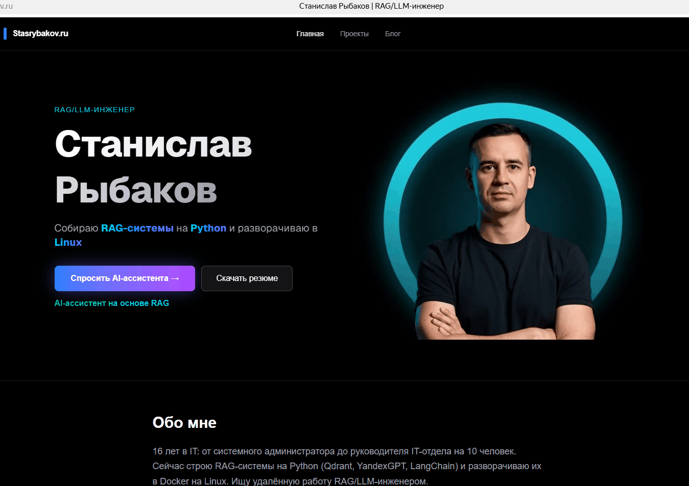

# RAG-портфолио Станислава Рыбакова

Интерактивный сайт-портфолио с AI-ассистентом, основанным на технологии **RAG (Retrieval-Augmented Generation)**. Посетители могут задавать вопросы о моих навыках, опыте и проектах, а ассистент отвечает на основе моей базы знаний.

**Живой сайт:** [https://stasrybakov.ru](https://stasrybakov.ru)

## 🚀 Особенности проекта

- **AI-ассистент:** Отвечает на вопросы, используя гибридный поиск.
- **Гибридный поиск (Hybrid Search):** Комбинация векторного поиска (эмбеддинги) и лексического поиска (TF-IDF) с объединением результатов через **Reciprocal Rank Fusion (RRF)**. Это повышает точность нахождения как смысловых, так и точных запросов.
- **Три режима ответа:** Ассистент адаптирует стиль общения под контекст (Recruiter, Technical, Casual).
- **Блог:** Написан на MDX с кастомной версткой.
- **Production-деплой:** Сайт и бэкенд работают в Docker-контейнерах на домашнем сервере Synology NAS. Настроены Reverse Proxy, SSL (Let's Encrypt) и поддомены.

## 🛠️ Технологии

**Фронтенд:**
- Next.js (App Router, Turbopack)
- React
- Tailwind CSS
- MDX (для блога)

**Бэкенд:**
- Node.js
- Express
- Qdrant (векторная база данных)
- YandexGPT API (генерация ответов)
- FastEmbed (эмбеддинги)

**Инфраструктура:**
- Docker, Docker Compose
- Synology NAS (DSM)
- Nginx (Reverse Proxy)

## ⚙️ Как запустить локально

1. Клонируй репозиторий:
   ```bash
   git clone https://github.com/Superstas87/RAG-Portfolio.git
   cd RAG-Portfolio

2. Установи зависимости для фронтенда:
   ```bash
   cd rag-portfolio
   npm install

3. Создай файл .env.local в папке rag-portfolio и укажи адрес API:
   ```bash
   NEXT_PUBLIC_API_URL=http://localhost:4000

4. Запусти фронтенд:
   ```bash
   npm run dev

5. Для запуска бэкенда (в отдельном терминале):
   ```bash
   cd rag-server
   npm install
   # Создай .env с ключами YandexGPT
   node server.js

6. Открой http://localhost:3000

📂 Структура проекта
```
RAG-Portfolio/
├── rag-portfolio/       # Next.js фронтенд
│   ├── app/             # Страницы и блог (MDX)
│   ├── components/      # React-компоненты
│   └── public/          # Статические файлы (картинки)
├── rag-server/          # Node.js бэкенд
│   ├── rag/             # Логика RAG (поиск, эмбеддинги, генерация)
│   └── server.js        # Express-сервер
├── docker-compose.yml   # Конфигурация Docker
└── README.md
```

🤝 Контакты
GitHub: @Superstas87
Telegram: @Superstas87
Email: dargo87@ya.ru

Проект создан для демонстрации навыков в RAG/LLM-инжиниринге и Production-деплое.

---
## 🙏 Credits
The initial idea and basic structure of this project were inspired by the [RAG-Portfolio](https://github.com/Pratham9911/RAG-Portfolio) template by Pratham Tiwari. 
The original repository did not include a license file. However, the code has been **heavily modified and extended** with new features:
- Hybrid Search (TF-IDF + Vector) with Reciprocal Rank Fusion (RRF).
- MDX-based blog.
- Production deployment on Synology NAS via Docker (Reverse Proxy, SSL).
- Redesigned UI and knowledge base.
The final code is licensed under the MIT License.
